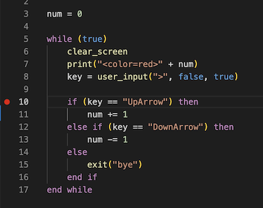

# Greybel for VS Code

Greybel VS adds GreyScript editing, builds, imports, execution, and debugging to VS Code. It supports `.src`, `.gs`, and `.ms` files in desktop VS Code and compatible web editors.

For command-line use, see the [CLI guide](cli.md). For the Grey Hack message hook and game setup, see [Grey Hack integration](greyhack-integration.md).

## Install

1. Install **Greybel VS** from the [Visual Studio Marketplace](https://marketplace.visualstudio.com/items?itemName=ayecue.greybel-vs) or [Open VSX](https://open-vsx.org/extension/ayecue/greybel-vs). VS Code 1.90 or later is required.
2. Open the folder containing your GreyScript project.
3. Open a `.src`, `.gs`, or `.ms` file to activate the extension.

Desktop packages contain the required native binaries. The web extension runs the language server, builder, runtime, and mock world in WebAssembly workers. Importing into Grey Hack and the in-game run environment require the desktop extension.

## Quick start

1. Create `main.src`:

   ```js
   print("Hello from Greybel")
   ```

2. Run **Greybel: Run file from context** from the Command Palette or editor context menu.
3. Enter program arguments when prompted, or leave the prompt empty.
4. Use **Greybel: Build file from context** to write the build to `build/`.

Add a [`greybel.json`](#project-configuration) when several files share an entry point or build settings.

## Features

- Syntax highlighting, completion, signature help, hover documentation, diagnostics, formatting, symbols, definitions, and references.
- Default, minified, and formatted transformations.
- Project builds with dependency bundling, installer generation, and optional deployment to Grey Hack.
- A generated mock Grey Hack world or an in-game run environment.
- Breakpoints, conditional breakpoints, hit conditions, logpoints, stepping, variable inspection and editing, and paused evaluation.
- A pseudo-terminal for program input and output, plus a TextMesh Pro output preview.
- API documentation, game-script snippets, comment-based type documentation, sharing, and navigation to the next error.

## Commands

Open the Command Palette with `Ctrl+Shift+P` (`Cmd+Shift+P` on macOS). Most commands also appear in the editor or Explorer context menu.

| Command | Action |
|---|---|
| **Greybel: Build root file** | Build the first path in `greybel.json`'s `entries`. |
| **Greybel: Build file from context** | Build the active or selected file. |
| **Greybel: Run root file** / **Debug root file** | Run or debug the first configured entry. |
| **Greybel: Run file from context** / **Debug file from context** | Run or debug the active or selected file. |
| **Greybel: Import file into the game** | Import the active file or a file/folder selected in the Explorer without building it. Desktop only. |
| **Greybel: Preview output** | Open the TextMesh Pro output preview. |
| **Greybel: API Documentation** | Open the searchable GreyScript API reference. |
| **Greybel: Snippets** | Open a game script snippet in a new document. |
| **Greybel: Share** | Save the active file through the editor service and copy its link. |
| **Greybel: Select profile** | Select the active project's build/run profile. |
| **Greybel: Reset the mock world** | Discard the current mock world and generate a new one. |

The editor's **Greybel: Transform** submenu contains **Transform**, **Uglify**, **Beautify**, and **Transform to clipboard**. **Greybel: Goto Error** in the editor context menu selects the next error in the current file.

## Project configuration

The CLI, MCP server, language server, and VS Code extension read the same optional `greybel.json`. Put it in the workspace folder root so VS Code can synchronize it with workspace settings. Paths are relative to the project folder.

```json
{
  "entries": ["src/main.src"],
  "extensions": ["src", "gs", "ms"],
  "build": {
    "mode": "Default",
    "output": "build",
    "variables": {
      "files": [".env"],
      "values": { "NAME": "value" }
    },
    "installer": {
      "active": true,
      "maxChars": 160000,
      "allowImport": false
    }
  },
  "run": {
    "seed": "test",
    "params": [],
    "programName": "myprogram",
    "memoryLimit": 1024,
    "variables": {
      "files": [".env"],
      "values": {}
    }
  },
  "profiles": {
    "release": {
      "build": { "mode": "Uglify" }
    },
    "release-obfuscated": {
      "extends": "release",
      "build": { "obfuscation": true }
    }
  }
}
```

Every field is optional. VS Code provides validation and completion for this file.

### Main fields

| Field | Meaning |
|---|---|
| `entries` | Entry files for builds and runs. VS Code's root-file commands use the first entry. |
| `extensions` | Extensions an import may omit, tried in order. Default: `src`, `gs`, `ms`. |
| `strictMode` | Reject Greybel conveniences that Grey Hack's compiler does not accept. Default: `false`. |
| `exclude` | Glob excluded from workspace type analysis. Default: `**/{node_modules,.*}/**`. |
| `format` | Formatting for the editor and beautified builds: `indentation`, `indentationSpaces`, and `retainParentheses`. |
| `build` | Transformation, output, deployment, installer, and build-variable settings. |
| `run` | Mock-world, argument, program-name, memory-limit, and run-variable settings. |
| `profiles` | Named overrides of `build` and `run`. |

### Profiles

Use **Greybel: Select profile** or the profile item in the status bar. The selection is stored as `greybel.profile`, not in `greybel.json`.

A profile replaces the base values it specifies. Objects merge key by key; arrays and scalar values replace the base value. `extends` applies another profile before the current profile's overrides.

### Settings synchronization

Project-backed settings synchronize between `greybel.json` and VS Code's workspace/workspace-folder settings:

- On startup, values in `greybel.json` take precedence.
- Changing a project-backed setting at workspace or folder scope writes it to `greybel.json`.
- Editing `greybel.json` updates the corresponding folder settings.
- User settings apply when no project manifest provides the configuration.
- Invalid JSON is left unchanged and is not synchronized.

Editor features and user-specific integration settings are not written to the manifest. These include `greybel.formatter`, `greybel.autocomplete`, `greybel.hoverdocs`, `greybel.diagnostic`, `greybel.interpreter.environmentType`, both message-hook ports, `greybel.interpreter.useDefaultArgs`, `greybel.interpreter.silenceErrorPopups`, `greybel.transpiler.watch`, `greybel.transpiler.ingameDirectoryPrompt`, and `greybel.createIngame.active`.

## Transform and build

### Transform a file

The transform commands operate on the active editor's text. They do not bundle dependencies.

- **Transform** uses `build.mode` and replaces the editor contents.
- **Uglify** or **Beautify** overrides the configured mode for that transformation.
- **Transform to clipboard** uses the configured mode without changing the file.

`Default` writes the code without comments or minification. `Uglify` minifies code and optimizes literals and namespaces. `Beautify` formats code using `format`.

Uglify settings include `disableLiteralsOptimization`, `disableNamespacesOptimization`, `excludedNamespaces`, and `obfuscation`. Obfuscation also shortens names read as strings, such as map keys; enable it only when the program does not depend on those names remaining unchanged.

Both builds and runs read `#envar` values from `variables.files` first and `variables.values` second. Later values override earlier values. Variable files contain `NAME=value` lines and are relative to the project folder; missing files are ignored.

### Build a project

**Build file from context** starts at the selected file. **Build root file** starts at the first configured entry. A build saves open files, resolves dependencies, and writes the result to `build.output` (default: `build`). The output folder is replaced on each build.

For a single-file build, `build.outputName` overrides the built entry file's name. Include its extension if the build will be auto-compiled in Grey Hack.

Enable `greybel.transpiler.watch` to rebuild the root file when project sources change. Files under the build output folder do not trigger another build.


### Dependencies

Greybel supports relative imports and resolves omitted extensions in the order given by `extensions`. Absolute import paths start at the project folder.

- `#include "path/to/file.src"` inserts the file's contents at each include. Its declarations share the including file's global scope.
- `#import utils from "path/to/file.src"` evaluates the module once, caches it, and binds `utils` to its `module.exports` map. The module is bundled into the root file.
- `import_code("path/to/file.src")` keeps code in separate in-game files and supports nested imports. Prefer it when a bundled root file would exceed Grey Hack's character limit. Nested imports move into the entry file, so keep `import_code` at the head of a file; other placement cannot be guaranteed.

Builds report dependency cycles. At runtime, the interpreter loads dependencies dynamically and supports cyclic dependencies.

For compile-time directives and syntax extensions, see [Source imports and directives](cli.md#source-imports-and-directives) and [Syntax extensions](cli.md#syntax-extensions).

### Installers

Installer generation is enabled by default. A build writes `installer0.src` and additional numbered installers when `build.installer.maxChars` requires splitting. Copy the installer code into Grey Hack, then compile and run it to recreate the build there. Grey Hack allows at most 160,000 characters per file.

- `build.installer.maxChars` sets the split limit; the default is `160000`.
- `build.autoCompile` makes the installer compile the program and delete its source files. Default: `true`.
- `build.installer.allowImport` permits the auto-compiled program to import code at runtime.
- `build.ingameDirectory` sets the destination and run folder in Grey Hack. Default: `/root/`.

### Import or deploy to Grey Hack

Set up the message hook as described in [Grey Hack integration](greyhack-integration.md) before using these desktop-only features.

- Set `greybel.createIngame.active` to deploy each build; local build output is also written. `greybel.createIngame.port` selects the message-hook port (default: `7777`). Deployment uses `build.deploy.allowImport` when auto-compile is enabled.
- Use **Greybel: Import file into the game** to copy a file or folder without transforming or bundling it. Folder contents retain their paths relative to the selected folder.

Both features use `build.ingameDirectory`. Enable `greybel.transpiler.ingameDirectoryPrompt` to choose the destination for each build or import.

## Run and debug

### Mock environment

The default `Mock` environment generates computers, networks, file systems, services, and other world state from `run.seed`. The same seed generates the same initial world. `get_shell("root", "test")` returns the local root shell.

All runtimes in the VS Code window share that world, and changes persist between runs. Use **Greybel: Reset the mock world** or change the seed to start again. `run.memoryLimit` limits a program's memory in MiB; `run.programName` sets the binary name used inside the world.

The mock environment is local and does not require Grey Hack. Some game-specific behavior can differ from the real game.

### In-game environment

Set `greybel.interpreter.environmentType` to `In-Game` to execute in Grey Hack through the message hook. `greybel.interpreter.port` selects its port (default: `7777`). Execution and debugging require **single-player**, the desktop extension, and the setup in [Grey Hack integration](greyhack-integration.md).

### Arguments and environment variables

By default, each run prompts for arguments and splits the entered text on spaces. Set `greybel.interpreter.useDefaultArgs` to `true` to skip the prompt and use `run.params` instead.

`run.variables` supplies `#envar` values during execution, independently of `build.variables`.

### Debugging

Use a debug command to enable breakpoints. The debugger supports stepping, pausing, stack traces, variable inspection and editing, conditional and hit-count breakpoints, and logpoints. Evaluate code in the Debug Console while the program is stopped at a breakpoint or paused.

Set breakpoints on executable, non-empty lines. You can also create a `launch.json` configuration:

```json
{
  "type": "greyscript",
  "request": "launch",
  "name": "Debug current entry",
  "program": "${workspaceFolder}/src/main.src"
}
```



### Terminal and output preview

Program input and output use the `greybel` pseudo-terminal. TextMesh Pro rich text is converted to ANSI where possible, so some formatting can be lost.

Open **Greybel: Preview output** before a run to see the same output rendered with TextMesh Pro formatting in a webview.


## Comment documentation

Comment annotations add signatures and types to hover information, completion, and diagnostics.

```js
// Greet a user.
// @example greet("Ada", 1)
// @param {string} name - Display name.
// @param {string|number} id - User identifier.
// @returns {string} - The greeting.
greet = function(name, id)
  return "Hello, " + name
end function
```

Use `@type` and `@property` to document a runtime object type. Use `@define` to give a value a documented type.

```js
// @type User
// @property {string} name
User = { "name": "" }

// @define {User}
currentUser = new User
```

Virtual types describe tooling-only interfaces without requiring a runtime implementation:

```js
// @vtype Repository
// @extends map
// @property {string} name
// @function find
  // @params {string} id
  // @returns {map}

// @define {Repository}
users = {}
```

Supported documentation annotations include `@description`, `@example`, `@param`/`@params`, `@returns`, `@type`, `@vtype`, `@extends`, `@property`, `@function`, and `@define`.

## Other tools

### API reference

**Greybel: API Documentation** opens the GreyScript API reference beside the editor. Examples can be inserted into the active document.


### Snippets, sharing, and errors

- **Greybel: Snippets** opens a selected game script in a new GreyScript document.
- **Greybel: Share** uploads the active file to the configured editor service and copies the resulting editor link.
- **Greybel: Goto Error** moves to the next diagnostic error, wrapping to the first error when necessary.

## Troubleshooting

### Greybel commands are missing

Open a `.src`, `.gs`, or `.ms` file. The extension activates for the GreyScript language, and many context commands are visible only for that language.

### The root-file command cannot find an entry

Set `entries` in `greybel.json` or use a file-from-context command. Entry paths are relative to the project folder; VS Code uses the first entry.

### An import cannot be resolved

Check the path's letter case and the extension order in `extensions`. Relative paths start at the importing file; absolute paths start at the project folder. Use a build rather than a transform when dependencies must be bundled.

### `greybel.json` changes do not apply

Confirm that the file is a valid JSON object in the workspace folder root. VS Code warns when invalid JSON prevents synchronization. Check for a selected profile that overrides the changed setting.

### A mock run sees old files or world state

Programs in the window share one persistent mock world. Run **Greybel: Reset the mock world** to discard its changes. This does not delete source files on disk.

### Grey Hack import, deployment, or in-game execution fails

Use the desktop extension, start Grey Hack, and verify the message-hook installation. Match `greybel.createIngame.port` or `greybel.interpreter.port` to the hook's port. See [Grey Hack integration](greyhack-integration.md) for installation and connection troubleshooting.

### Execution error popups are distracting

Set `greybel.interpreter.silenceErrorPopups` to `true`. Errors remain visible in the pseudo-terminal.

## Related documentation

- [CLI guide](cli.md)
- [Grey Hack integration](greyhack-integration.md)
- [Greybel VS changelog](../apps/ts/greybel-vs/CHANGELOG.md)
- [GreyScript API documentation](https://documentation.greyscript.org)
