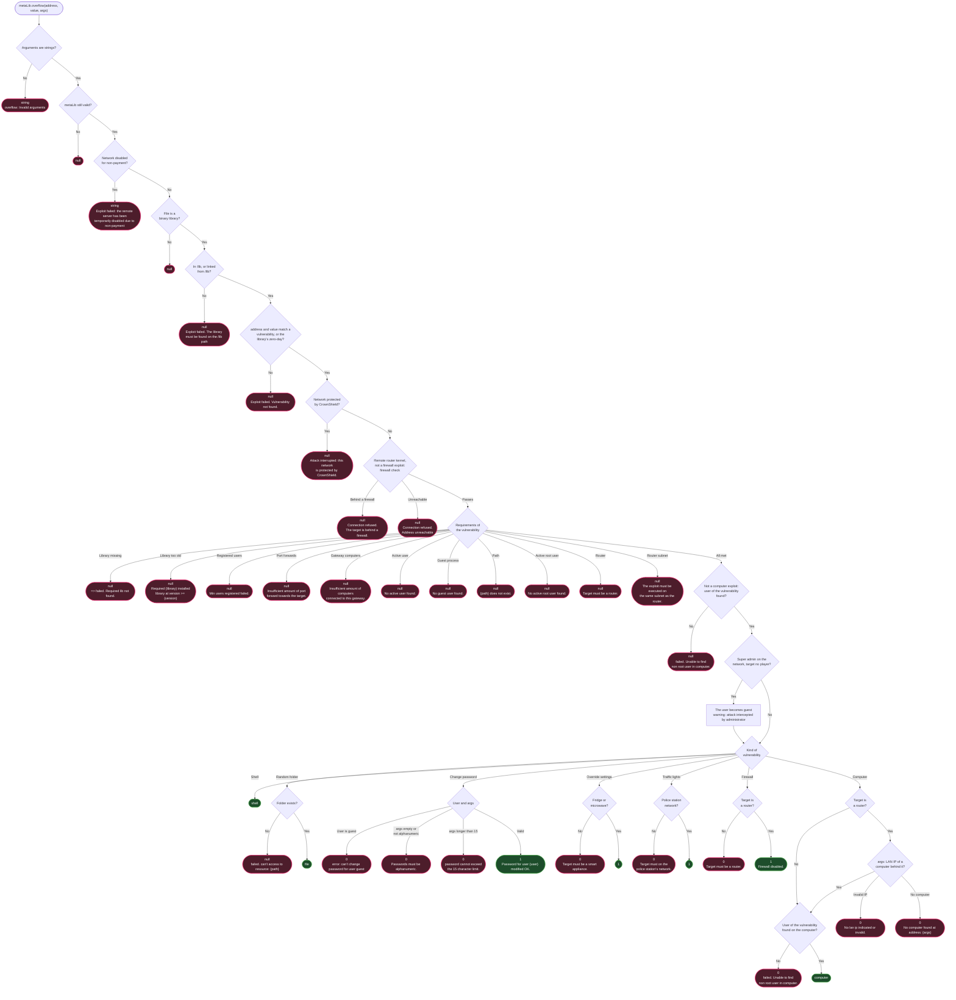

# Exploits

A library exploit takes three steps. `metaxploit.load` (local file) or `metaxploit.net_use` (remote service, then `get_metaLib`) gives a `metaLib`. `metaxploit.scan` lists its memory addresses, and `metaxploit.scan_address` lists the unsafe values at an address. `metaLib.overflow(address, value, args)` then runs the exploit and returns what it obtained.

```
metax = include_lib("/lib/metaxploit.so")
session = metax.net_use("12.12.12.12", 22)
lib = session.dump_lib
address = metax.scan(lib)[0]
print metax.scan_address(lib, address)
result = lib.overflow(address, "unsafe_value")
print typeof(result)
```

## Result of overflow

`overflow` returns `null`, a string or `0` when the exploit fails, and prints why. What it returns on success depends on the vulnerability: a `shell`, a `computer`, a `file`, or `1` for vulnerabilities that change something on the target.

| Vulnerability     | Success                                                     | Failure |
| ----------------- | ----------------------------------------------------------- | ------- |
| Shell             | `shell`                                                     | `null`  |
| Random folder     | `file` of the folder                                        | `null`  |
| Computer          | `computer`; on a router, of the LAN address given in `args` | `0`     |
| Change password   | `1`; the user's password becomes `args`                     | `0`     |
| Override settings | `1`; a fridge or microwave allows overriding its settings   | `0`     |
| Traffic lights    | `1`; the police station's traffic lights can be overridden  | `0`     |
| Firewall          | `1`; the router's firewall is disabled                      | `0`     |

## Flow of overflow

The checks `overflow` makes, in order, as of Grey Hack 0.9.7389. Each end shows the return value and, below it, the message `overflow` prints.


